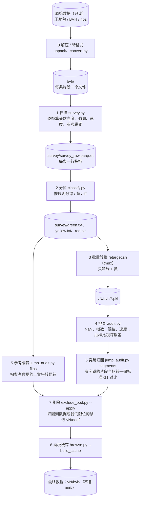

# 数据集 → g1d 总流程

每个数据集一个文件夹（`bones_seed`、`hiphi`、`lafan`、`grab`、`omomo`、`amass`、`embody3d`），里面的 `SOP.md` 写各自不同的地方。
这里是共同的步骤。原始数据只读，所有产物都在 `{数据集}_retarget/` 下。

| 步骤 | 做什么 | 耗时（实测） | 什么时候要重跑 |
|---|---|---|---|
| 0 解压 / 转格式 | 把原始包解开，或转成 loader 读的格式 | 读盘为主：OMOMO 3 min，Embody3D 197 GB 13 min（16 进程） | 只做一次 |
| 1 扫描 | 每条片段用 loader 完整读一遍（和转换一样：SMPL-X 逐帧算出身体，再拼每帧每个关节的朝向），算分区要用的指标 | 和数据帧数成正比：GRAB 3.8 h 数据 12 min、OMOMO 9.8 h 13 min（本机 20 进程）；Embody3D 501 h 约 1.5 h 以上（服务器 64 进程） | loader 改了（读出来的动作变了）才要重扫；只改分区规则不用 |
| 2 分区 | 只读扫描表，按阈值和文字规则分区，写名单 | 几秒 | 改分区规则后 |
| 3 批量转换 | IK 转到 g1d，每条一个 pkl；同时刷新面板缓存 | 和转换的帧数成正比：AMASS 13251 条 43 h 约 20 min（64 进程） | 分区或转换代码变了，开新版本 vN |
| 4 检查 | 全量查 NaN、帧数、限位、速度；抽 300 条重算跟踪误差、自碰撞 | AMASS 约 3 min（8 进程） | 每个新版本 |
| 5 参考翻转 | 扫绿、黄片段的参考数据，看上臂扭转有没有整段翻转 | 和扫描差不多慢（AMASS 8 进程 20 min 以上） | 参考数据或 loader 变了才要；只是重转可以沿用旧的 `ref_twist_flips.csv` |
| 6 突跳归因 | 对有手臂突跳的片段当场转一遍标准 G1，判断突跳怪数据、怪速度还是怪限位 | 和突跳片段数成正比：AMASS 约 14 min（8 进程） | 每个新版本 |
| 7 剔除 OOD | 先打印名单，`--apply` 再移动 | 几秒 | 每个新版本 |
| 8 面板缓存 | 补齐面板要的逐帧缓存 | 转换时已在刷新，最后补一次几秒到几分钟 | 剔除后 |

服务器是共享的：转换、扫描用 64 进程，检查步骤（4–6）用 `--workers 8`，同一时间只跑一个大任务（见 `amass/SOP.md`）。
